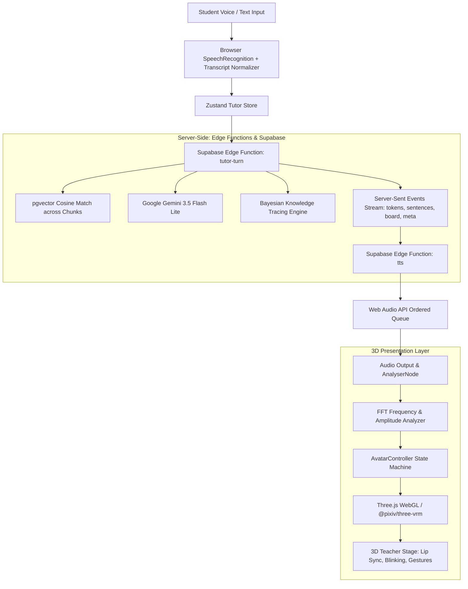

# MyGuru AI Teacher

MyGuru is a real-time, 3D AI computer science teacher that delivers adaptive, spoken lessons in English and Indian Hinglish. It combines interactive 3D avatar presentation with Bayesian Knowledge Tracing (BKT), dynamic pedagogy selection, low-latency streaming, audio-driven lip sync, and instant conversational interruption.

---

## Architecture Overview



---

## Features

- **3D Avatar Presentation:**
  - Standard VRM avatar loading via `@pixiv/three-vrm` from `public/avatars/teacher.vrm` ($\le 8\text{ MB}$).
  - Built-in procedural 3D teacher character with articulated head, hair, glasses, blinking eyelids, responsive vowel-morphing mouth, navy blazer, and gesturing arms when VRM is absent.
  - Automatic graceful 2D fallback for low-spec devices or environments without WebGL.
  - Reduced motion preference (`prefers-reduced-motion`) compliance.
- **Audio-Driven Lip Sync:**
  - Formant frequency analysis mapping live audio to standard VRM mouth expressions (`aa`, `ih`, `ou`, `ee`, `oh`) with exponential smoothing ($<100\text{ms}$ latency).
- **Avatar State Machine:**
  - `idle`: Breathing cycle (spine/chest pitch), periodic blinking every 3–6s, subtle eye saccades.
  - `listening`: Head tilts ($\sim 5\text{--}7^\circ$) with occasional nods while student speaks.
  - `thinking`: Gaze moves upward and aside in a pensive posture.
  - `speaking`: Conversational arm gesturing and head nods synchronized with speech cadence.
  - `pointing_board`: Outstretched arm pointing towards the digital board on new board events.
- **Instant Interruption ($<100\text{ms}$):**
  - Typing in the input, speaking a new turn, or pressing **Stop** immediately halts TTS audio playback, aborts in-flight SSE streams, zeroes avatar mouth shapes, and resumes listening mode.
- **Natural Indian Hinglish Support:**
  - Real-time grammatical transcript normalizer disambiguates homophones (e.g. *array* vs *arey*, *queue* vs *kyon* / *q*) while preserving authentic Hindi vocabulary.
- **Adaptive Pedagogy & BKT:**
  - Bayesian Knowledge Tracing tracking concept mastery ($P(L_0) = 0.30$, $P(T) = 0.15$, $P(G) = 0.20$, $P(S) = 0.10$).
  - Pedagogical move policies adapting difficulty, offering worked examples, and adjusting hints based on learner behavior.
- **Conversational Memory:**
  - Multi-turn conversation history maintained across turns with greeting suppression on follow-up questions.

---

## Prerequisites

1. **Node.js**: v18 or higher (tested on Node.js v24 LTS).
2. **Supabase CLI**: installed locally (`npx supabase`).
3. **Google Gemini API Key**: from Google AI Studio.

---

## Setup & Deployment Guide

### 1. Clone & Install Dependencies

```bash
git clone https://github.com/your-username/myguru.git
cd myguru
npm install
```

### 2. Configure Environment Variables

Create `.env` from `.env.example`:

```bash
cp .env.example .env
```

Fill in your Supabase project keys:

```env
VITE_SUPABASE_URL=https://your-project-ref.supabase.co
VITE_SUPABASE_ANON_KEY=your-supabase-anon-key
```

### 3. Database Migration & Seed

Run the database migrations and seed the question bank and curriculum:

```bash
# Link to your Supabase project (if not already linked)
npx supabase link --project-ref your-project-ref

# Run SQL migrations
npx supabase db push

# Alternatively, execute migrations via the Supabase Dashboard SQL Editor:
# 1. supabase/migrations/001_init.sql
# 2. supabase/migrations/002_match_chunks.sql
# 3. supabase/seed.sql
```

### 4. Configure Supabase Edge Function Secrets

Set your Gemini API secrets on the remote Supabase project:

```bash
npx supabase secrets set GEMINI_API_KEY=your_gemini_api_key
npx supabase secrets set GEMINI_MODEL=gemini-3.5-flash-lite
npx supabase secrets set GEMINI_EMBED_MODEL=gemini-embedding-001
npx supabase secrets set GEMINI_TTS_MODEL=gemini-2.5-flash
npx supabase secrets set MYGURU_SUPABASE_SERVICE_ROLE_KEY=your-service-role-key
```

### 5. Deploy Edge Functions

Deploy the backend tutor streaming turn and TTS functions:

```bash
npx supabase functions deploy tutor-turn --no-verify-jwt
npx supabase functions deploy tts --no-verify-jwt
```

### 6. Ingest Course Content Chunks & Embeddings

Run the ingestion script to chunk the curriculum files in `/content` and generate 768-dimensional pgvector embeddings:

```bash
npx tsx scripts/ingest.ts
```

### 7. Adding a Custom 3D VRM Model

To use a custom 3D avatar:
1. Acquire a VRM 0.0 or 1.0 humanoid avatar model (e.g. from VRoid Hub).
   > **Note on Model Licensing:** Please check the model's license and usage terms (commercial use, redistribution, and attribution requirements).
2. Ensure the model file size is under **8 MB** per SPEC.md.
3. Place the file at:
   ```text
   public/avatars/teacher.vrm
   ```
4. If this file is missing or omitted, MyGuru's built-in 3D procedural teacher activates automatically.

---

## Running the Application Locally

Start the local Vite development server:

```bash
npm run dev
```

Open your browser at `http://localhost:5173`.

---

## Running Automated Tests

MyGuru includes a comprehensive Vitest test suite with $\ge 5$ test cases each for all critical modules:

```bash
npx vitest run
```

### Test Coverage Summary:
- `src/tests/avatarController.test.ts`: State machine, gestures, breathing, blinking, interruption ($<100\text{ms}$), reduced motion (6 tests)
- `src/tests/audioQueue.test.ts`: In-order sentence queuing, audio buffer playback, interruption (5 tests)
- `src/tests/bkt.test.ts`: Bayesian Knowledge Tracing updates, clamping, convergence (5 tests)
- `src/tests/pedagogy.test.ts`: Pedagogy moves, streak difficulty, breaks, misconceptions (5 tests)
- `src/tests/answer_checker.test.ts`: Numeric arithmetic evaluation, MCQ exact/case-insensitive checking (5 tests)
- `src/tests/transcriptNormalizer.test.ts`: ASR homophone disambiguation, Hindi preservation (20 tests)

---

## Building for Production

Build the client application:

```bash
npm run build
```

The output bundle will be generated in `dist/` with the 3D presentation canvas automatically code-split for fast initial page load.
